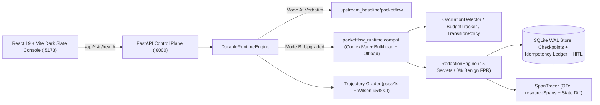
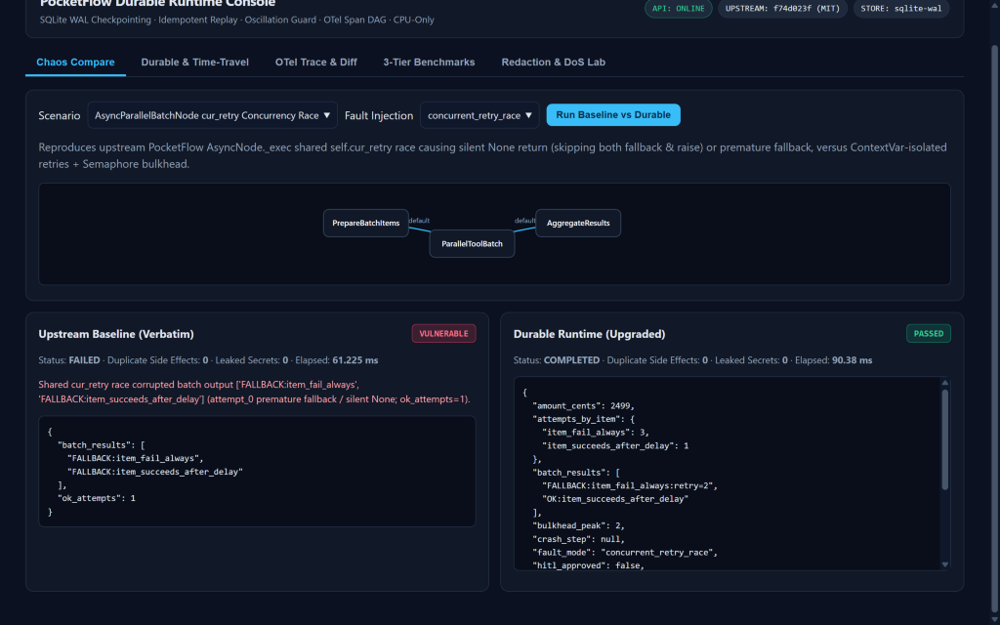
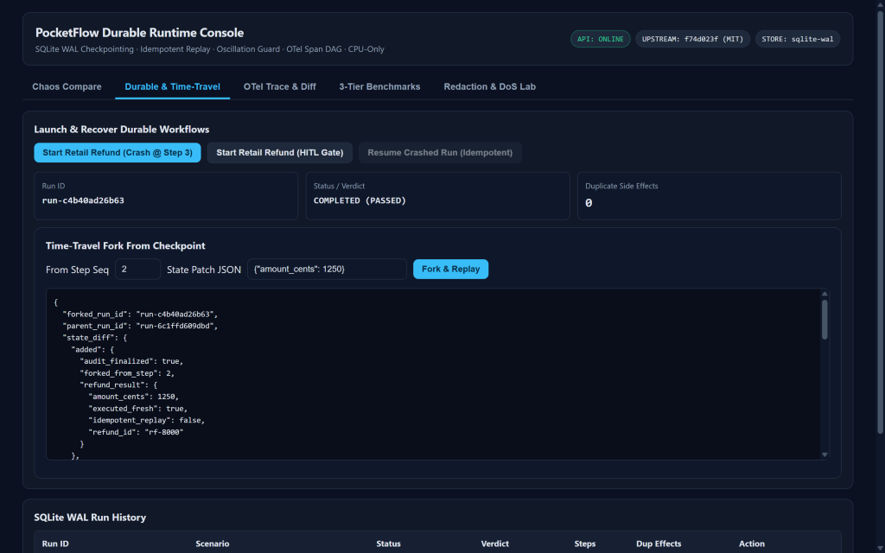
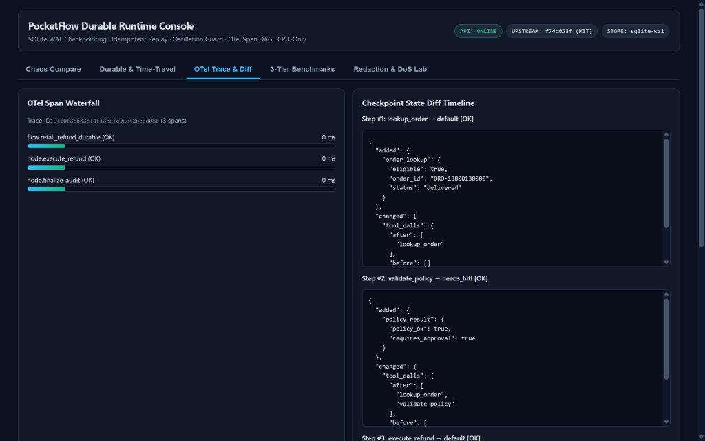
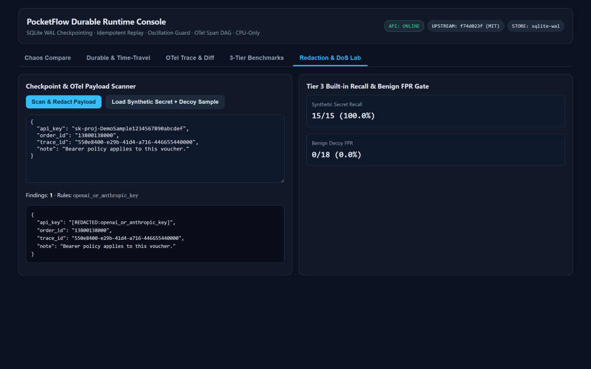

# PocketFlow Durable Runtime

[English](README.md) | [简体中文](README.zh.md)

A local **durable execution, concurrency-safe, OpenTelemetry-observable, and trajectory-evaluated runtime** built on top of [`The-Pocket/PocketFlow`](https://github.com/The-Pocket/PocketFlow) (commit `f74d023f93607b8c3268133339a5e532a949898c`, MIT License). Runs **100% locally on CPU** with zero paid LLM API dependencies.

---

## Why This Upgrade Exists (Reproducible Upstream Defects Solved)

While PocketFlow's 100-line graph kernel is an elegant minimal abstraction (`prep -> exec -> post`), inspecting and executing the unmodified upstream core exposes five critical production reliability gaps:

| Defect ID | Upstream Root Cause (`pocketflow/__init__.py`) | Observed Failure Mode | Durable Runtime Fix (`pocketflow_runtime`) |
| :--- | :--- | :--- | :--- |
| **#1 Concurrency Race** | `AsyncNode._exec` binds `self.cur_retry` on the shared instance while `AsyncParallelBatchNode` fans out via `asyncio.gather`; `items=None` raises `TypeError` | Concurrent tasks overwrite `self.cur_retry`, causing silent `None` returns or premature fallback on attempt 0 | `ContextVar`-isolated retry index (`cur_retry`), `(items or [])`, `asyncio.Semaphore` bulkhead, `isolate_errors` mode, seeded jittered backoff & circuit breaker |
| **#2 Volatile Execution** | `Flow._orch` & `AsyncFlow._orch_async` hold cursors and `shared` strictly in RAM | Process crashes lose progress and replay non-idempotent tools (duplicate refunds/mutations); no HITL pause | **SQLite WAL** per-step checkpoints + SHA-256 checksums + **Idempotency Ledger** for simulated refunds + durable HITL & **Time-Travel Fork** |
| **#3 Infinite Loops** | Bare `while curr:` loop with zero step/cycle/timeout/budget caps | Cyclic reflection (`Plan <-> ToolError`) hangs indefinitely until killed | `OscillationDetector` (canonical state cycle detection), `BudgetTracker` (steps/wall-clock/tokens), per-node `asyncio.wait_for` |
| **#4 Branch Aliasing & Loop Stall** | `copy.copy` shallow-copies nested `params`; `AsyncFlow` calls sync `Node._run` directly on the event loop | Parallel branches corrupt shared nested params; sync `time.sleep`/CPU stalls sibling coroutines | Cycle-safe deep-cloned branch params (`isolate_branch_params`) + `asyncio.to_thread` sync-node offloading (`offload_sync_nodes`) |
| **#5 Blind Observability** | `Flow.get_next_node` silently exits with `warnings.warn`; no Span DAG, redaction, or `pass^k` gate | Hallucinated actions drop silently; raw secrets persist in state; no multi-step CI eval | Configurable `TransitionPolicy` (`strict`/`fallback`/`dead_letter`), OTel `resourceSpans` + JSON state-diff, bounded secret redaction, `pass^k` Wilson CI gate |

---

## Architecture Overview



---

## Console Screenshots

| Chaos Compare (Baseline `VULNERABLE` vs Durable `PASSED`) | Durable HITL & Time-Travel Fork |
| :---: | :---: |
|  |  |

| OTel Span Waterfall & State Diff | 3-Tier Sealed Benchmarks & Redaction Lab |
| :---: | :---: |
|  |  |

---

## Three-Tier Offline Replay With External Data

| Tier and source | License | Cases | Upstream baseline | Durable runtime |
| --- | --- | --- | --- | --- |
| **Tier 1A · [τ-bench](https://github.com/sierra-research/tau-bench)** | MIT | 156 × 3 trials (3,000 records) | `12.82%` pass `[0.0845, 0.1897]`, `pass^3 = 0.1282`, **408** duplicate mutations, P95 `0.272 ms`, P99 `0.388 ms` | `100.0%` pass `[0.976, 1.0]`, `pass^3 = 1.0`, **0** duplicate mutations, P95 `40.306 ms`, P99 `44.472 ms` |
| **Tier 1B · [BFCL v4](https://github.com/ShishirPatil/gorilla)** | Apache-2.0 | 824 (5 files, 0 skipped) | `44.66%` pass `[0.413, 0.4807]`, P95 `0.045 ms`, P99 `0.105 ms` | `100.0%` pass `[0.9954, 1.0]`, P95 `0.087 ms`, P99 `0.169 ms` |
| **Tier 2 · [AgentDojo](https://github.com/ethz-spylab/agentdojo)** | MIT | 86 (4 suites) | `0.0%` resilience `[0.0, 0.0428]` | `100.0%` resilience `[0.9572, 1.0]`, median oscillation trip `0.05 ms` |
| **Tier 3 · Secret, PII and resource limits** | MIT | 15 secrets, 18 decoys, 3 resource checks | — | `100.0%` recall (`15/15`), `0.0%` benign FPR (`0/18`), peak fan-out `16`, cycle and `262144`-byte caps passed |

The τ-bench replay evaluated 113 retail and 43 airline tasks from 165 available tasks. Pass rates and Wilson 95% intervals use distinct tasks. Duplicate counts cover all three trials. Durable timing includes SQLite synchronous commits and reconnection after simulated interruption. The database record count describes input inventory.

BFCL replays tool outputs and routing under the same faults on both sides. AgentDojo task indices schedule three synthetic chaos checks. Tier 3 uses synthetic samples. All five gates passed in `12.23 s` on local CPU. [test_metrics.json](docs/test_metrics.json)

---

## REST & SSE API Surface

See [`docs/API_CONTRACT.md`](docs/API_CONTRACT.md) and [`backend/docs/openapi.json`](backend/docs/openapi.json).

| Method & Path | Purpose |
| :--- | :--- |
| `GET /health` | Service liveness check (`{"status": "ok"}`) |
| `GET /api/v1/meta` | Upstream commit SHA, storage mode, and CPU-only runtime metadata |
| `GET /api/v1/scenarios` | List built-in fault-injection & durability workflow scenarios with graph topology |
| `POST /api/v1/runs` / `GET /api/v1/runs` / `GET /api/v1/runs/{run_id}` | Launch durable runs and inspect persisted SQLite WAL checkpoints & idempotency ledger |
| `POST /api/v1/runs/{run_id}/resume` | Resume a `CRASHED` workflow from its latest checkpoint without duplicate mutations |
| `POST /api/v1/runs/{run_id}/hitl` | Approve or reject a persisted `PAUSED_HITL` interrupt and resume execution |
| `POST /api/v1/runs/{run_id}/fork` | Time-travel fork from any historical `step_seq` with optional state JSON patch & diff |
| `GET /api/v1/runs/{run_id}/trace` / `GET /api/v1/runs/{run_id}/stream` | Fetch OTel `resourceSpans` JSON waterfall or stream checkpoints/spans over SSE |
| `POST /api/v1/compare` | Run verbatim `upstream_baseline` vs `durable_runtime` side-by-side (`No False Greens`) |
| `POST /api/v1/eval/redaction` | Scan custom payloads and run the 15-secret / 18-decoy Tier 3 validation suite |
| `GET /api/v1/benchmarks` | Serve the replay metrics and gate outcomes from `docs/test_metrics.json` |

---

## 3-Step Quickstart

### 1. Backend Setup & Verification
```powershell
uv venv .venv --python 3.12
uv pip install --python .venv\Scripts\python.exe -e "backend[dev]"
.venv\Scripts\pytest.exe tests\backend -v
```

### 2. Frontend Setup & Verification
```powershell
npm --prefix frontend install
npm --prefix frontend run test -- --run
npm --prefix frontend run build
```

### 3. Run Local Full-Stack Console
```powershell
# Terminal 1 (Backend :8000)
.venv\Scripts\uvicorn.exe pocketflow_runtime.api:app --host 127.0.0.1 --port 8000

# Terminal 2 (Frontend :5173)
npm --prefix frontend run dev -- --host 127.0.0.1 --port 5173
```

For sealed external benchmark reproduction, see [`datasets/README.md`](datasets/README.md) and [`docs/USAGE_GUIDE.md`](docs/USAGE_GUIDE.md).

---

## Attribution & License

- Built on [`The-Pocket/PocketFlow`](https://github.com/The-Pocket/PocketFlow) (`f74d023f93607b8c3268133339a5e532a949898c`, MIT License, `Copyright (c) 2024 Zachary Huang`).
- Licensed under the [MIT License](LICENSE).
