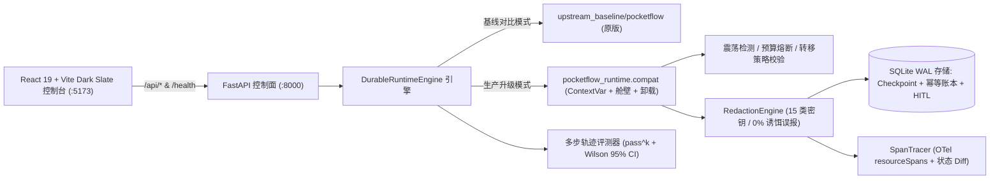
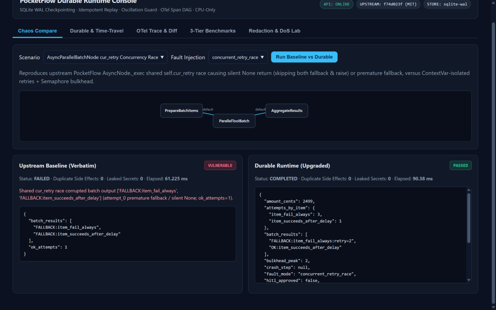
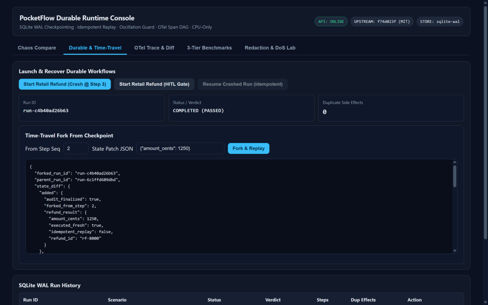
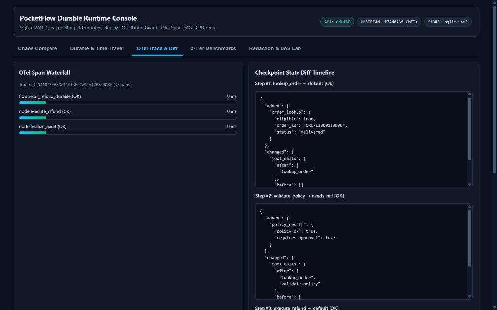
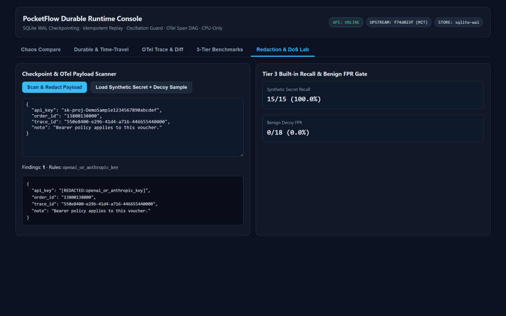

# PocketFlow Durable Runtime（持久化与可观测 Agent 运行时）

[English](README.md) | [简体中文](README.zh.md)

基于独立开源项目 [`The-Pocket/PocketFlow`](https://github.com/The-Pocket/PocketFlow)（Commit `f74d023f93607b8c3268133339a5e532a949898c`，MIT 协议）复现并升级的**持久化、并发安全、OpenTelemetry 可观测、带多步轨迹评测门禁的 Agent 工作流运行时**。全栈 **100% 本地 CPU 运行**，零付费大模型 API 依赖。

---

## 核心升级与原版源码缺陷修复对照

`PocketFlow` 原版仅 100 行核心代码（`prep -> exec -> post`），在生产多步 Agent 场景中存在 5 个可确定性复现的工程缺陷：

| 缺陷编号 | 原版根因（`pocketflow/__init__.py`） | 实测故障表现 | 升级版解决方案（`pocketflow_runtime`） |
| :--- | :--- | :--- | :--- |
| **#1 异步并发竞态** | `AsyncNode._exec` 将 `self.cur_retry` 绑定在共享实例上，被 `AsyncParallelBatchNode` 并发改写；`items=None` 漏判空 | 并发协程互相覆盖 `cur_retry`，导致静默返回 `None` 或第 0 次重试就提前触发 Fallback；传入 `None` 抛 `TypeError` | 基于 `ContextVar` 的协程隔离重试计数、安全 `(items or [])`、`asyncio.Semaphore` 并发舱壁、`isolate_errors` 容错模式、确定性种子指数退避与熔断器 |
| **#2 易失内存执行** | `Flow._orch` 与 `AsyncFlow._orch_async` 仅在内存中维护执行游标和 `shared` | 进程崩溃丢失进度并重放非幂等工具导致**重复扣款/退款**；无 HITL 暂停恢复能力 | **SQLite WAL** 逐歩 Checkpoint（SHA-256 校验）+ **幂等副作用账本**（模拟退款）+ 持久化 HITL 审批门禁 + **时间旅行 Fork 回放** |
| **#3 死循环与预算失控** | 无保护 `while curr:` 循环，缺少步数、震荡、超时与预算上限 | `Plan <-> ToolError` 乒乓循环永久挂死工作进程 | `OscillationDetector`（定长窗口检测重复状态）、`BudgetTracker`（步数/耗时/虚拟 Token 熔断）、单节点 `asyncio.wait_for` 超时 |
| **#4 浅拷贝污染与事件循环阻塞** | `copy.copy` 浅拷贝嵌套 `params`；`AsyncFlow` 直接调用同步 `Node._run` | 并行分支篡改共享嵌套参数；同步节点阻塞同事件循环所有其他并发协程 | 循环引用安全深拷贝隔离（`isolate_branch_params`）+ `asyncio.to_thread` 卸载同步节点（`offload_sync_nodes`） |
| **#5 可观测与评测缺失** | `Flow.get_next_node` 遇到未知 Action 仅发 `warnings.warn` 静默结束；无 Span DAG、无脱敏、无 `pass^k` | 幻觉动作静默丢单；密钥原样写入状态；缺少多步回归门禁 | 可配置 `TransitionPolicy`（`strict`/`fallback`/`dead_letter`）、OTel `resourceSpans` 瀑布图 + 状态 Diff、有输入上限的脱敏器、`pass^k` Wilson 置信区间门禁 |

---

## 系统架构图



---

## 控制台截图

| 混沌对比（原版 `VULNERABLE` vs 升级版 `PASSED`） | 持久化 HITL 审批与时间旅行 Fork |
| :---: | :---: |
|  |  |

| OTel Span 瀑布图与每步状态 Diff | 密钥脱敏与 DoS 实验室 |
| :---: | :---: |
|  |  |

---

## 三层外部数据离线回放（本地 CPU）

| 层级与数据源 | 协议 | 样本 | 上游基线 | 持久化运行时 |
| --- | --- | --- | --- | --- |
| **Tier 1A · [τ-bench](https://github.com/sierra-research/tau-bench)** | MIT | 156 × 3 轮（3,000 条记录） | `12.82%` 通过率 `[0.0845, 0.1897]`, `pass^3 = 0.1282`, **408** 次重复变更, P95 `0.272 ms`, P99 `0.388 ms` | `100.0%` 通过率 `[0.976, 1.0]`, `pass^3 = 1.0`, **0** 次重复变更, P95 `40.306 ms`, P99 `44.472 ms` |
| **Tier 1B · [BFCL v4](https://github.com/ShishirPatil/gorilla)** | Apache-2.0 | 824（5 个文件，0 个跳过） | `44.66%` 通过率 `[0.413, 0.4807]`, P95 `0.045 ms`, P99 `0.105 ms` | `100.0%` 通过率 `[0.9954, 1.0]`, P95 `0.087 ms`, P99 `0.169 ms` |
| **Tier 2 · [AgentDojo](https://github.com/ethz-spylab/agentdojo)** | MIT | 86（4 个套件） | `0.0%` 韧性率 `[0.0, 0.0428]` | `100.0%` 韧性率 `[0.9572, 1.0]`, 震荡拦截中位数 `0.05 ms` |
| **Tier 3 · 密钥、PII 与资源限制** | MIT | 15 密钥、18 诱饵、3 项资源检查 | — | `100.0%` 召回率（`15/15`），`0.0%` 良性误报率（`0/18`），扇出峰值 `16`，循环引用和 `262144` 字节上限通过 |

τ-bench 从 165 个任务中评估了 113 个零售任务和 43 个航空任务。通过率与 Wilson 95% 区间以独立任务为单位，重复变更计数覆盖每题三轮。持久化端延时包含 SQLite 同步提交和故障后重新连接。数据库记录数用于数据源盘点。

BFCL 用同一故障计划回放选定文件的工具输出和路由。AgentDojo 的任务索引用于调度三种合成混沌检查。Tier 3 使用合成样本。五项门禁均通过，本地 CPU 总耗时 `12.23 s`。 [test_metrics.json](docs/test_metrics.json)

---

## 三步快速启动

### 1. 后端安装与测试（两套实现各 56 个原样上游用例）
```powershell
uv venv .venv --python 3.12
uv pip install --python .venv\Scripts\python.exe -e "backend[dev]"
.venv\Scripts\pytest.exe tests\backend -v
```

### 2. 前端安装、契约测试与构建
```powershell
npm --prefix frontend install
npm --prefix frontend run test -- --run
npm --prefix frontend run build
```

### 3. 启动全栈控制台
```powershell
# 终端 1：启动 FastAPI 后端 (:8000)
.venv\Scripts\uvicorn.exe pocketflow_runtime.api:app --host 127.0.0.1 --port 8000

# 终端 2：启动 Vite 前端 (:5173)
npm --prefix frontend run dev -- --host 127.0.0.1 --port 5173
```

外部盲测数据集复现命令与接口说明详见 [`datasets/README.md`](datasets/README.md)、[`docs/USAGE_GUIDE.md`](docs/USAGE_GUIDE.md) 与 [`docs/API_CONTRACT.md`](docs/API_CONTRACT.md)。

---

## 上游致谢与开源协议

- 上游基线：[`The-Pocket/PocketFlow`](https://github.com/The-Pocket/PocketFlow)（Commit `f74d023f93607b8c3268133339a5e532a949898c`，MIT License，`Copyright (c) 2024 Zachary Huang`）。
- 本项目继续采用 [MIT License](LICENSE) 开源。
